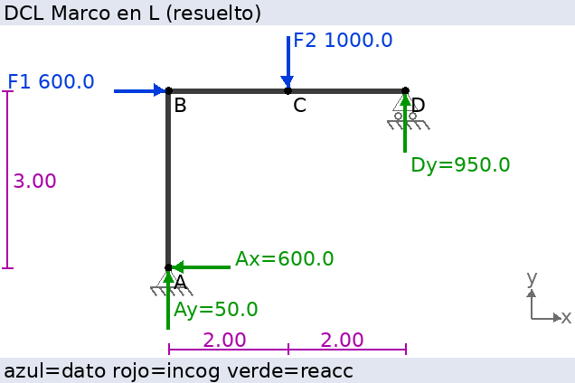
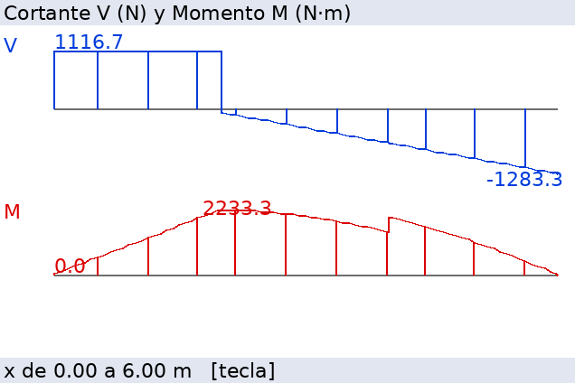

# Engineering Solver v1.0 (TI-Nspire CX II CAS)

Solucionador de problemas de **estática 2D** paso a paso, escrito en Python
para la **TI-Nspire CX II / CX II CAS** (OS 5.2 o posterior). No es una
calculadora de fórmulas. Con él se puede:

1. **Construir** el problema por coordenadas (menús) o **dibujarlo** en un
   editor gráfico con cursor. Los dos métodos editan el mismo modelo.
2. Poner **apoyos** (articulación, rodillo, empotramiento, cable/tensor,
   biela), **cargas** (fuerzas horizontales, verticales, inclinadas o dadas
   por componentes, momentos, cargas distribuidas lineales) y **fuerzas
   desconocidas**.
3. **Resolver** ΣFx = 0, ΣFy = 0, ΣM = 0 con un motor propio (Gauss con
   pivoteo parcial). El motor también **clasifica** el sistema: determinado,
   indeterminado (con su grado), incompatible o geométricamente inválido.
   Cuando no hay solución única, no inventa una.
4. Ver la **solución en 14 pasos**: identificación, DCL, descomposición,
   brazos de momento, elección del punto de momentos, planteamiento,
   sustitución, desarrollo algebraico, resolución, resultados con unidades
   y comprobación del equilibrio.
5. Ver el **diagrama de cuerpo libre** gráfico. Los datos salen en azul, las
   incógnitas en rojo discontinuo y las reacciones calculadas en verde, con
   su sentido real. En vigas también muestra los **diagramas V y M** y las
   fuerzas internas en una sección.




## Archivos para la calculadora (`dist/`)

| Archivo | Uso |
|---|---|
| `dist/EngSolver.py` | **Aplicación completa** en un solo archivo (recomendado) |
| `dist/EngSolver_lite.py` | Igual, sin la batería de autopruebas (ocupa menos memoria) |
| `dist/EngTest.py` | Solo el motor y las 218 autopruebas |
| `dist/modular/*.py` | Versión en varios módulos (alternativa si falta memoria) |
| `*.tns` | Se generan con el workflow **Generar .tns**; ver [INSTALACION](docs/INSTALACION.md) |

## Documentación

- [Instalación paso a paso en la calculadora](docs/INSTALACION.md)
- [Manual de uso](docs/MANUAL.md)
- [Ejercicios de prueba resueltos (teoría)](docs/EJERCICIOS.md) y
  [salida real del programa paso a paso](docs/EJERCICIOS_PASO_A_PASO.md)
- [Fase 1: compatibilidad y restricciones de la calculadora](docs/COMPATIBILIDAD.md)
- [Pruebas y validación](docs/PRUEBAS.md)
- [Limitaciones conocidas](docs/LIMITACIONES.md)

## Arquitectura (`src/`)

```
config.py       configuración, unidades, formato numérico, modo ASCII
vectores.py     vectores 2D/3D: suma, punto, cruz, unitario, momentos
matrices.py     Gauss-Jordan con pivoteo, rango, det, inversa (n x m)
expresion.py    evaluador seguro de expresiones (500*cos(30), sqrt(2)…)
geometria.py    distancias, brazos, resultantes de cargas distribuidas
elementos.py    modelo: nodos, miembros, apoyos, cargas, incógnitas
estatica2d.py   motor de equilibrio, clasificación, comprobación, V y M
solucionador.py desarrollo paso a paso (14 pasos)
graficos.py     DCL y diagramas con ti_draw; menús y entrada gráfica
editor.py       configurador por dibujo (cursor sobre rejilla)
entrada.py      entrada validada, menús y paginador en el shell
guardar.py      guardar/cargar problemas en variables del documento
ejemplos.py     11 problemas de referencia con solución conocida
herramientas.py herramientas matemáticas
pruebas.py      batería de validación (también corre en la calculadora)
interfaz.py     navegación, configurador por coordenadas, asistentes
main.py         menú principal
```

El 3D y la dinámica ya tienen hueco en la arquitectura: los vectores y el
producto cruz son 3D, Gauss trabaja con n × m y los menús ya muestran esas
entradas como bloqueadas.

## Desarrollo en PC

```
python tools/build.py      # genera dist/ y verifica compatibilidad MicroPython
python tools/test_pc.py    # 218 pruebas + 18 sesiones de uso simuladas
python tools/gen_docs.py   # regenera docs/EJERCICIOS_PASO_A_PASO.md
```

`tools/mock/` contiene simuladores de escritorio de `ti_draw` y `ti_system`
que permiten probar y capturar los gráficos en PC.
