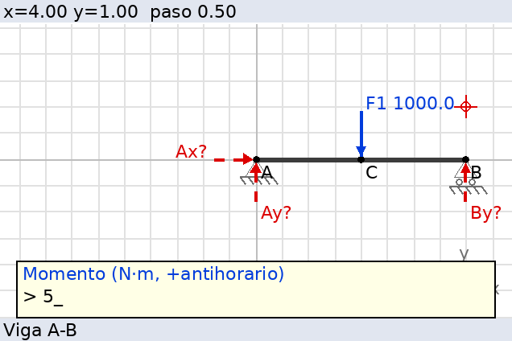

# Manual de uso: Engineering Solver v1.0

## 1. Convenciones

| Magnitud | Convención |
|---|---|
| Ejes | x hacia la derecha, y hacia arriba |
| Ángulos | en **grados**, medidos desde **+x en sentido antihorario** (0° derecha, 90° arriba, 180° izquierda, 270° abajo) |
| Momentos | **positivo antihorario**, negativo horario. M = rx·Fy − ry·Fx |
| Incógnitas | se suponen en sentido positivo: Ax hacia +x, Ay hacia +y, cables tirando hacia el anclaje. Un **resultado negativo** significa que el sentido real es el contrario |
| Unidades | `CONFIGURACION > Unidades` (N–m, kN–m, lb–ft, kip–ft, lb–in). Solo cambian las etiquetas: los datos deben ser coherentes |

**Entrada de números.** Cualquier campo numérico admite **expresiones**:
`500*cos(30)`, `3/5`, `2^2+1`, `sqrt(2)/2`, `1.5e3`, `2pi`. La
trigonometría trabaja en grados. `ENTER` vacío acepta el valor por defecto
que aparece entre `[ ]`, y `q` cancela la operación.

**Puntos.** Donde se pide un punto se puede escribir el **nombre del nodo**
(`A`) o unas **coordenadas** `x,y` (`2.5,0`). Si no existe un nodo en esas
coordenadas, se crea automáticamente.

**Paginador.** Los textos largos se detienen cada N líneas (configurable).
`ENTER` continúa y `q` sale. En el paso a paso: `ENTER` pasa al siguiente
paso, `a` vuelve al anterior, `n7` salta al paso 7 y `q` sale.

## 2. Menú principal

```
1 ESTATICA
2 DINAMICA  [bloqueado: futuro]
3 HERRAMIENTAS MATEMATICAS
4 CONFIGURACION
0 Salir
```

### ESTÁTICA

| Opción | Qué hace |
|---|---|
| 1 Equilibrio 2D | Problema nuevo de cuerpo rígido; se elige coordenadas o dibujo |
| 2 Equilibrio 3D | Bloqueado (futuro) |
| 3 Partículas | Asistente rápido (P en el origen, cables, peso, fuerzas) o configuración libre. Usa 2 ecuaciones |
| 4 Cuerpos rígidos | Problema nuevo de cuerpo rígido |
| 5 Vigas y estructuras | Asistente de viga horizontal o estructura libre (marcos, plumas…) |
| 6 Ejemplos resueltos | 11 problemas de referencia listos para resolver |
| 7 Continuar problema actual | Vuelve al último problema |
| 8 Cargar problema guardado | Recupera las ranuras 1–9 |

## 3. Configurador por coordenadas

Es el menú **PROBLEMA**. El dibujo y las coordenadas modifican **el mismo
modelo**, así que cualquier cambio en un sitio aparece en el otro.

| Opción | Contenido |
|---|---|
| 1 Puntos / nodos | Listar, agregar (`x,y`), **mover** (la geometría y el dibujo se actualizan) y borrar (también borra todo lo que cuelga del nodo) |
| 2 Vigas y barras | Miembros entre dos puntos: viga, barra o cuerpo rígido (geometría y dibujo) |
| 3 Apoyos | Articulación (Rx, Ry), rodillo (N con ángulo), empotramiento (Rx, Ry, M), cable/tensor (T hacia un anclaje o con ángulo; solo tracción) y biela (F a lo largo de la biela) |
| 4 Fuerzas conocidas | Por magnitud y ángulo, por componentes, horizontal, vertical o *dirigida hacia un punto*. Se pueden editar |
| 5 Momentos | Par aplicado (+ antihorario) |
| 6 Cargas distribuidas | Lineales entre dos puntos: uniforme (w1 = w2), triangular (una es 0) o trapezoidal. Dirección por defecto: 270° (abajo). Intensidad por unidad de longitud del segmento |
| 7 Fuerzas desconocidas | Con **dirección conocida** (1 incógnita) o **libre** (Px, Py: 2 incógnitas) |
| 8 Editor gráfico | Abre el configurador por dibujo |
| 9 Ver diagrama | DCL gráfico (tecla para volver) |
| 10 Resumen del modelo | Lista todo y cuenta incógnitas y ecuaciones |
| 11 RESOLVER | Resuelve y abre el menú de resultados |
| 12 Guardar problema | Ranuras 1–9 (variables `esprob#`) |
| 13 Tipo | Cambia entre cuerpo rígido y partícula |

**Rodillo.** El ángulo es la dirección de la **reacción N**, perpendicular a
la superficie y hacia el cuerpo. Sobre suelo horizontal: 90°. Sobre un plano
inclinado α: 90 + α. Sobre una pared vertical a la izquierda del cuerpo: 0°.

**Cable.** Lo más cómodo es dar el **punto de anclaje**: el programa calcula
el vector unitario u = r/|r|. Si el resultado sale negativo, avisa de que el
cable estaría en compresión, lo que no es físico.

**Todos los puntos pertenecen a un único cuerpo rígido.** Los miembros
sirven para dibujar la geometría y para las cargas distribuidas.

## 4. Configurador por dibujo (editor gráfico)



La barra superior muestra la posición del cursor (`x`, `y`), el nodo que hay
debajo `[A]` y el paso de la rejilla.

| Tecla | Acción |
|---|---|
| Flechas | Mover el cursor por la rejilla |
| `+` / `-` | Aumentar o reducir el paso de la rejilla (0.1 … 10) |
| `enter` | En un punto vacío crea un nodo; sobre un nodo abre su **menú** (apoyo, fuerza, momento, miembro, carga, incógnita, editar, borrar) |
| `n` | Crear nodo |
| `b` | Viga/barra: se marca el inicio, se lleva el cursor al final y se pulsa `enter` |
| `s` | Apoyo en el nodo (los cables y bielas piden el anclaje con el cursor) |
| `f` | Fuerza (magnitud y ángulo, o componentes) |
| `m` | Momento |
| `w` | Carga distribuida (inicio en el cursor, fin con el cursor) |
| `u` | Fuerza desconocida |
| `e` | Editar: coordenadas exactas del nodo o valores de sus fuerzas y momentos |
| `d` / `del` | Borrar un elemento del nodo o el nodo completo |
| `c` | Ir a una coordenada exacta |
| `h` | Ayuda |
| `r` | **Resolver** |
| `esc` | Salir al configurador por coordenadas |

Los menús gráficos se contestan con las **teclas numéricas**. Los números se
escriben en el recuadro amarillo (dígitos, `.`, `-`, `del` para borrar,
`enter` para aceptar y `esc` para cancelar). Si tu calculadora no envía
alguna tecla, cambia `CONFIGURACION > Entrada en editor` a **shell**.

## 5. Resultados

| Opción | Contenido |
|---|---|
| 1 Resumen | Estado, valores con unidades y sentido real, resultante de cada articulación y comprobación |
| 2 Solución PASO A PASO | Los 14 pasos (ver abajo) |
| 3 DCL con reacciones | Dibujo con las reacciones en verde y su sentido real |
| 4 Momento respecto a un punto | Contribución de cada fuerza respecto a cualquier nodo o `x,y` |
| 5 Cambiar punto de momentos | Se vuelve a resolver tomando momentos en el punto elegido (ENTER = automático) |
| 6 Fuerzas internas en una sección | *Solo vigas horizontales*: N, V y M en x, con el detalle del tramo izquierdo |
| 7 Diagramas V y M | *Solo vigas horizontales*: gráficos con los valores extremos |

### Los 14 pasos

1. **Identificación**: tipo de cuerpo, puntos, elementos, apoyos e
   incógnitas que aporta cada apoyo.
2. **Diagrama de cuerpo libre**: lista de todas las fuerzas, con sus
   sentidos supuestos (el gráfico está en la opción 3).
3. **Conocidas y desconocidas**: conteo de incógnitas frente a ecuaciones.
4. **Descomposición**: Fx = F·cosθ, Fy = F·sinθ, resultante y centroide de
   las cargas distribuidas, vectores unitarios de los cables.
5. **Brazos de momento**: r = P − O, M = rx·Fy − ry·Fx, d = |M|/|F| y
   sentido de giro.
6. **Punto de referencia**: el que elimina más incógnitas y por qué.
7. **ΣFx = 0**, 8. **ΣFy = 0** y 9. **ΣM = 0**: forma simbólica y con
   valores.
10. **Sustitución**: términos conocidos al lado derecho y forma matricial
    [A | b].
11. **Desarrollo algebraico**: se despeja primero la ecuación que tiene una
    sola incógnita y el valor se sustituye en las demás. Las ecuaciones que
    sobran sirven de comprobación, o muestran la **contradicción** si el
    sistema es incompatible.
12. **Resolución del sistema**: si quedan incógnitas acopladas, Gauss-Jordan
    con cada operación de fila; además, análisis de rango y clasificación.
13. **Resultados** con unidades, interpretación de los signos y resultantes.
14. **Comprobación**: ΣFx, ΣFy y ΣM respecto a varios puntos, con todas las
    fuerzas.

### Clasificación del sistema

| Estado | Condición | Qué muestra |
|---|---|---|
| Determinado | rango(A) = n = rango([A\|b]) | Solución única. Si n < 3, avisa de que el cuerpo está *parcialmente restringido* |
| Indeterminado | rango(A) = rango([A\|b]) < n | Grado = n − rango. Lista las incógnitas que aun así quedan determinadas. **No inventa** el resto |
| Incompatible | rango(A) < rango([A\|b]) | Ninguna reacción equilibra las cargas: mecanismo, o reacciones paralelas o concurrentes |
| Inválido | Nodos coincidentes, longitud cero, cable hacia sí mismo, cargas con signos mixtos, fuerzas no concurrentes en una partícula… | Lista de errores |

## 6. Herramientas matemáticas

Cada herramienta muestra su procedimiento.

1. **Descomposición vectorial**: 2D (F, θ), 3D por ángulos directores (con
   la comprobación cos²α + cos²β + cos²γ = 1) y 3D según un vector de
   dirección.
2. **Resultante** de n fuerzas: Rx, Ry, |R| y θ.
3. **Momento de una fuerza**: 2D escalar con brazo, o 3D como r × F.
4. **Producto cruz** con el desarrollo por componentes.
5. **Sistemas de ecuaciones** de hasta 8 × 8, no necesariamente cuadrados:
   Gauss-Jordan con operaciones de fila, rango, determinante y residuo.
6. **Conversión de unidades**: fuerza, longitud, momento, carga distribuida,
   presión, masa y ángulos.
7. **Vectores 2D/3D**: suma, resta, producto punto y ángulo, producto cruz,
   módulo, unitario y proyección.

## 7. Configuración

Decimales, sistema de unidades, símbolos ASCII (si la fuente no muestra Σ °
·), líneas por página, ancho de línea, modo de entrada del editor, paso de
rejilla, **autopruebas** y *Acerca de*.

## 8. Ejemplo completo: viga con el asistente

`1 ESTATICA` > `5 Vigas` > `1 Asistente`:

```
Longitud total L (m): 6
Apoyos: 1 (Articulacion) x=0 ; 2 (Rodillo) x=6, N=90 ; 0
Cargas: 1 Fuerza x=2, 1200, angulo 270
        2 Distribuida desde 2 hasta 6, w=300, 300
        3 Momento x=4, M=-500   (horario)
        0
```

Resultado: `Ax = 0`, `Ay = 1116.667 N`, `By = 1283.333 N`. A continuación
se puede ver el paso a paso, el DCL, las fuerzas internas y los diagramas V
y M.
